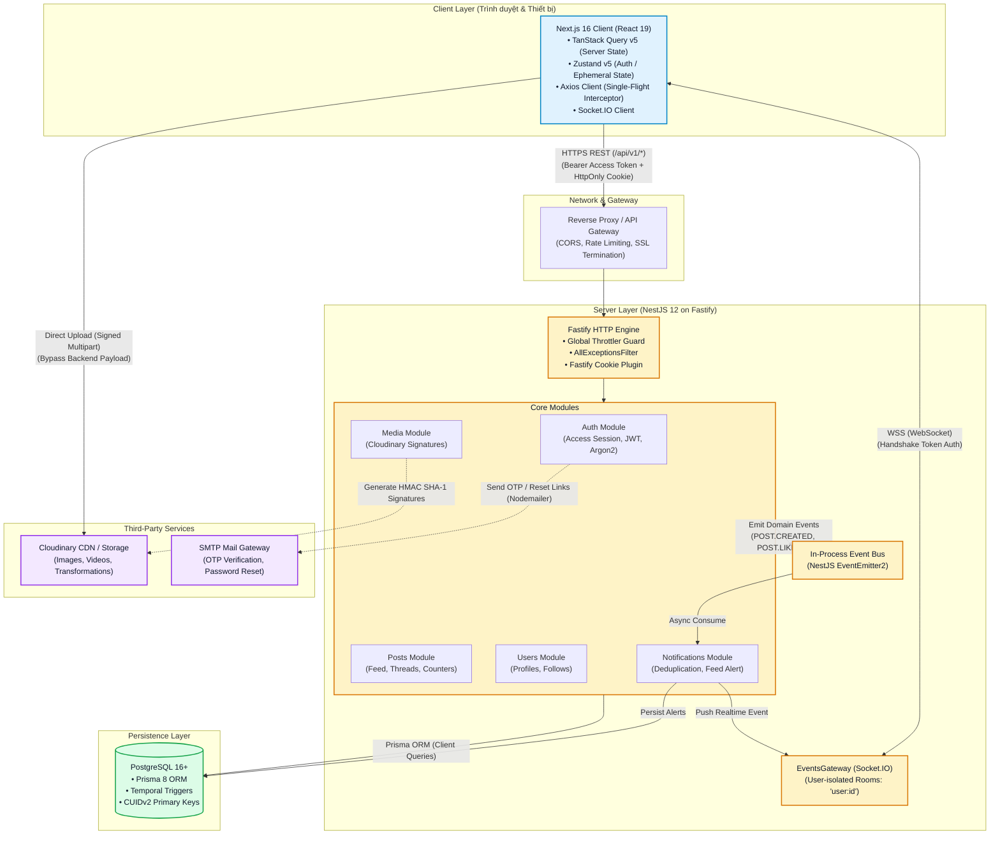
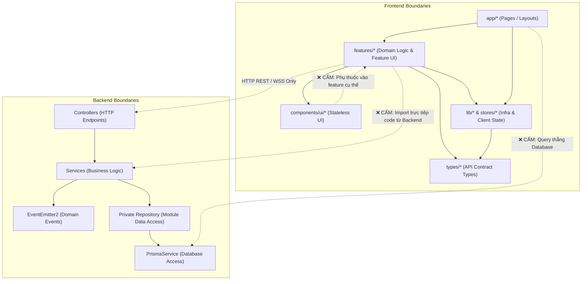
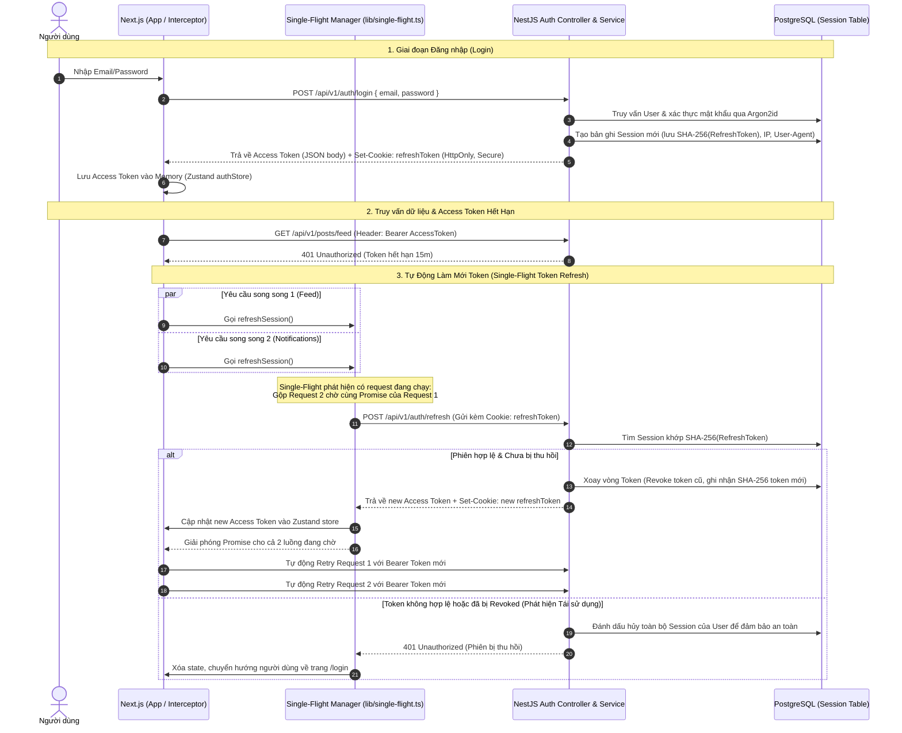
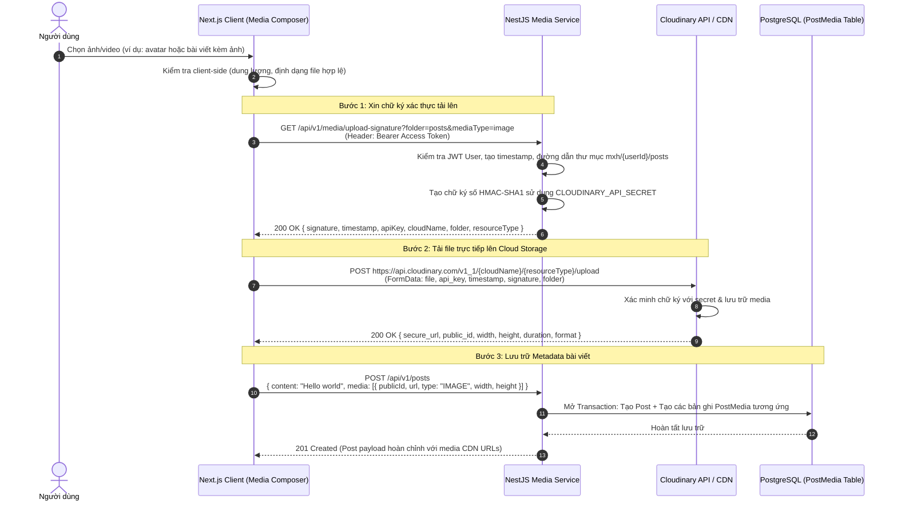

# 01. Kiến Trúc Tổng Thể Hệ Thống (Architecture Blueprint)

Tài liệu này định nghĩa kiến trúc tổng thể, ranh giới giữa các hệ thống (Server, Client, Third-party), ma trận công nghệ, quy tắc phân lớp dữ liệu và các quyết định kiến trúc cốt lõi (ADR) của dự án Mạng Xã Hội (MXH).

---

## 1. Sơ Đồ Tổng Quan Hệ Thống (System Overview Diagram)

Hệ thống được thiết kế theo mô hình **Monorepo (Turborepo)** phân tách rõ ràng giữa Client (Next.js 16 App Router) và Server (NestJS 12 chạy trên Fastify Engine), giao tiếp qua giao thức HTTPS RESTful API và WebSocket (Socket.IO) hai chiều. Các tác vụ nặng như lưu trữ media và gửi mail được ủy quyền cho các dịch vụ chuyên biệt (Cloudinary, SMTP).



---

## 2. Ma Trận Công Nghệ (Tech Stack & Vai Trò)

| Tầng (Layer) | Công nghệ / Thư viện | Phiên bản | Vai trò & Bài toán giải quyết trong dự án |
| :--- | :--- | :--- | :--- |
| **Monorepo Engine** | Turborepo | ^2.11 | Quản lý multi-package (`frontend`, `backend`), tối ưu build pipeline, caching artifact, chạy đồng thời dev server. |
| **Frontend Framework** | Next.js (App Router) | ^16.4 | Cung cấp routing hiện đại (Route Groups `(auth)`, `(main)`), hybrid rendering, tối ưu Core Web Vitals và SEO. |
| **UI Library & Style** | React 19 + Tailwind CSS | v19.2 / v4.x | Render component hiệu năng cao, compiler mới loại bỏ memoization dư thừa; Tailwind v4 styling hệ thống pastel hiện đại. |
| **Client Server-State** | TanStack React Query | ^5.104 | Caching, deduplication request, quản lý vòng đời query, pagination, infinite scroll và optimistic updates. |
| **Client Local-State** | Zustand | ^5.0 | Quản lý state gọn nhẹ: session token, current user info, socket state (tránh re-render không cần thiết). |
| **HTTP Client** | Axios | ^1.20 | Quản lý interceptor đính kèm JWT Bearer Token, bắt lỗi 401 và thực thi luồng refresh token dạng **Single-Flight**. |
| **Client Realtime** | Socket.IO Client | ^4.8 | Kết nối WSS tới backend, nhận real-time notification, feed updates và cập nhật UI tức thời. |
| **Backend Framework** | NestJS | ^12.0 | Kiến trúc module phân lớp chuẩn chỉnh (Controller -> Service -> Repository), Dependency Injection, Guards, Pipes. |
| **Backend HTTP Engine** | Fastify (`@nestjs/platform-fastify`) | ^5.12 | Thay thế Express mặc định, tối ưu throughput xử lý request cao gấp 2–3 lần, giảm memory footprint và CPU overhead. |
| **Database & ORM** | PostgreSQL + Prisma ORM | v16+ / v8.0-rc | RDBMS quan hệ chuẩn ACID; Prisma contract quản lý type-safe schema, migrations, quan hệ CUIDv2 và temporal timestamps. |
| **Security & Auth** | Argon2 + `@nestjs/jwt` + Fastify Cookie | ^0.45 / ^12.0 / ^11.1 | Băm mật khẩu kháng GPU cracking (Argon2id), ký/giải mã JWT access token, phát hành HttpOnly Secure Refresh Token. |
| **Event Bus** | `@nestjs/event-emitter` (EventEmitter2) | ^12.0 | Xử lý bất đồng bộ in-process: tách biệt nghiệp vụ chính (tạo bài viết/like) khỏi tác vụ phụ (tạo notification, push socket). |
| **Realtime Gateway** | Socket.IO (`@nestjs/platform-socket.io`) | ^4.8 / ^12.1 | Quản lý WebSocket connection, phân phòng theo user ID (`user:<userId>`), ép ngắt kết nối khi thu hồi phiên (revocation). |
| **Media Storage** | Cloudinary SDK | ^2.11 | Sinh Presigned Upload Signature cho client upload trực tiếp; quản lý CDN, tối ưu chuyển đổi ảnh/video on-the-fly. |
| **Email Service** | Nodemailer | ^10.0 | Gửi mã xác thực OTP 6 số (đăng ký) và link khôi phục mật khẩu qua SMTP có template HTML responsive. |

---

## 3. Bản Đồ Thư Mục & Luật Phân Ranh Giới (Directory Structure & Boundaries)

### 3.1. Cấu Trúc Thư Mục Cấp Cao

```text
├── .github/                  # CI/CD Workflows
├── backend/                  # NestJS API & WebSocket Service
│   ├── src/
│   │   ├── auth/             # Xác thực, phân quyền, quản lý session, guard
│   │   ├── common/           # Filter, search parser, common DTOs, utilities
│   │   ├── events/           # Định nghĩa Domain Event Types & Payload contracts
│   │   ├── gateway/          # Socket.IO Gateway, theo dõi user online, push event
│   │   ├── mail/             # Nodemailer templates & mail delivery service
│   │   ├── media/            # Sinh Cloudinary signatures & quản lý media lifecycle
│   │   ├── notifications/    # Xử lý logic thông báo & lắng nghe domain events
│   │   ├── posts/            # Nghiệp vụ bài viết, thread, quote, repost, like, bookmark
│   │   ├── prisma/           # Schema Prisma, DB client connection, extensions
│   │   ├── scripts/          # Scripts seed dữ liệu, reconcile counter reconciler
│   │   ├── users/            # Quản lý profile cá nhân, follow/unfollow
│   │   ├── app.module.ts     # Root NestJS Module
│   │   └── index.ts          # Entry point bootstrap server (Fastify)
├── docs/                     # Hệ thống Playdoc kiến trúc & quy chuẩn dự án
│   ├── 01-architecture.md    # Kiến trúc tổng thể, boundaries, ADR
│   ├── 02-backend-db.md      # Database schema, migrations, auth, services
│   ├── 03-frontend-ui.md     # Cấu trúc component, forms, state management
│   ├── 04-conventions.md     # Coding conventions, git flow, API response specs
│   └── 05-runbook-deploy.md  # Quy trình build, deploy, backup & troubleshooting
├── frontend/                 # Next.js 16 Client App Router
│   ├── app/                  # Next.js App Router (Routes & Layouts)
│   │   ├── (auth)/           # Route Group: login, register, verify-otp, forgot-password
│   │   ├── (main)/           # Route Group: feed, explore, bookmarks, notifications, profile
│   │   ├── layout.tsx        # Root HTML Layout
│   │   └── providers.tsx     # React Query, Auth Session Init, Theme Providers
│   ├── components/           # UI Components dùng chung toàn ứng dụng
│   │   ├── common/           # Shared components (InfiniteScroll, NavigationProvider...)
│   │   ├── layout/           # Sidebar, TopBar, MobileNav, RightPanel, DiscoveryPanel
│   │   └── ui/               # Nguyên tử UI nguyên bản: Avatar, Button, Modal, Spinner
│   ├── features/             # Feature-driven Modules (Đóng gói theo nghiệp vụ)
│   │   ├── auth/             # Components, Hooks, API callers liên quan xác thực
│   │   ├── media/            # Upload widget, media picker, preview logic
│   │   ├── notifications/    # Notification list, notification item row
│   │   ├── posts/            # Feed composer, post cards, thread view, reply box
│   │   ├── realtime/         # Socket hooks (`useSocket`)
│   │   └── users/            # Profile header, edit profile modal, follow buttons
│   ├── lib/                  # Utilities, single-flight client, axios instance, socket
│   ├── stores/               # Zustand stores: authStore, notificationStore
│   └── types/                # TypeScript Interface, DTOs trả về từ API
├── package.json              # Root npm workspace configuration
└── turbo.json                # Turborepo task pipeline definition
```

### 3.2. Quy Tắc Chiều Mũi Tên (Dependency & Boundary Rules)



1. **Ranh giới Tuyệt đối giữa Client và Server**:
   - `frontend/` **tuyệt đối không bao giờ** được `import` code từ `backend/src/` (kể cả file schema prisma hay service).
   - Mọi giao tiếp giữa frontend và backend đều phải thông qua **Network Contract**:
     * HTTP RESTful Request (JSON Payload qua `/api/v1/*`).
     * WebSocket Event Messages (Socket.IO).
     * Các TypeScript interface tương ứng được đồng bộ tại `frontend/types/api.ts`.
2. **Quy tắc Phân Tầng Frontend (Feature-Driven Architecture)**:
   - `components/ui/*` là các component hiển thị thuần túy (presentational/dumb components, ví dụ `Button`, `Avatar`, `Modal`). Chúng chỉ nhận `props` và render UI, không được chứa business logic, không gọi API, không import từ `features/` hay `stores/`.
   - `features/<name>/*` đóng gói toàn bộ logic nghiệp vụ của một miền cụ thể (ví dụ: `features/posts` quản lý composer, thread view, post query). Các feature khác nhau chỉ được trao đổi thông qua export công khai hoặc qua global state (`stores/`).
   - `app/*` chỉ đóng vai trò là "Routing & Layout Assembler": ghép các feature components lại thành trang, cấu hình metadata và xử lý Next.js layout hierarchy.
3. **Quy tắc Phân Tầng Backend**:
   - **Controllers**: Chỉ tiếp nhận request, validate DTO (thông qua `ValidationPipe`), trích xuất thông tin người dùng từ Decorator (`@CurrentUser()`) và gọi Services tương ứng. Không viết business logic trong Controller.
   - **Services**: Nơi chứa toàn bộ business logic. Thực thi các thao tác đọc/ghi dữ liệu qua repository nội bộ của module; chỉ repository gọi `PrismaService`.
   - **Cross-module Decoupling**: Khi một thao tác ở module này cần kích hoạt hành vi ở module khác (ví dụ: `PostsService` tạo bài viết mới cần gửi thông báo cho follower), service **không gọi trực tiếp** sang service của module khác nếu gây vòng lặp phụ thuộc (`circular dependency`). Thay vào đó, service phát ra **Domain Event** (`this.eventEmitter.emit(...)`) để module đích tự lắng nghe.

---

## 4. Luồng Dữ Liệu Trọng Yếu (Core Data Flows)

### 4.1. Luồng Xác Thực, Session & Single-Flight Token Refresh

Hệ thống sử dụng cơ chế **Dual-Token**:
- **Access Token (JWT)**: Thời hạn ngắn (15 phút), lưu trong bộ nhớ RAM client (`authStore`), gửi qua header `Authorization: Bearer <token>`.
- **Refresh Token**: Thời hạn dài (7 ngày), lưu trong cookie `HttpOnly, Secure, SameSite=Lax`. Trong cơ sở dữ liệu, mã băm SHA-256 của token được lưu trong bảng `Session`.
- **Single-Flight Mechanism**: Khi nhiều request đồng thời gặp lỗi `401 Unauthorized` hoặc khi ứng dụng khởi động lại, frontend gộp tất cả các yêu cầu cấp lại token vào **duy nhất một HTTP call** `/auth/refresh`, ngăn chặn triệt để lỗi race condition xoay vòng token (Token Rotation Desync).



---

### 4.2. Luồng Upload Media Trực Tiếp (Direct-to-Cloudinary via Presigned Signature)

Nhằm bảo vệ server backend khỏi việc xử lý các file nhị phân (binary) cồng kềnh gây nghẽn Event Loop và tốn băng thông, hệ thống áp dụng cơ chế **Presigned Upload Signature**:



---

### 4.3. Luồng Sự Kiện Bất Đồng Bộ & Thông Báo Thời Gian Thực (Realtime Notification Pipeline)

Toàn bộ các tương tác (Like, Reply, Repost, Quote, Follow) đều tuân theo mô hình **Event-Driven**: nghiệp vụ chính hoàn tất trước, các tác vụ phụ trợ (ghi nhận thông báo, bắn WebSocket) được tách biệt hoàn toàn qua In-Process Event Bus (`EventEmitter2`).

```mermaid
sequenceDiagram
    autonumber
    actor UserA as Người tương tác (User A)
    participant PostsCtrl as Posts Controller / Service
    participant DB as PostgreSQL
    participant EventBus as In-Process Event Bus (EventEmitter2)
    participant NotifListener as Notifications Listener
    participant WsGateway as EventsGateway (Socket.IO)
    actor UserB as Tác giả nhận tin (User B)

    UserA->>PostsCtrl: POST /api/v1/posts/:id/like (Header: Bearer Token User A)
    PostsCtrl->>DB: Thực thi Transaction: Thêm PostLike & Tăng likeCount trong Post (Atomic)
    DB-->>PostsCtrl: Transaction Success

    %% Phát Domain Event
    PostsCtrl->>EventBus: emit(POST_EVENTS.LIKED, { postId, postAuthorId: UserB, actorId: UserA })
    PostsCtrl-->>UserA: 200 OK { liked: true, likeCount: N } (Phản hồi tức thì)

    %% Xử lý sự kiện bất đồng bộ
    Note over EventBus, WsGateway: Xử lý Side-Effect Bất Đồng Bộ
    EventBus->)NotifListener: handlePostLiked(event)

    alt UserA == UserB (Tự like bài của mình)
        NotifListener->>NotifListener: Bỏ qua (không tạo thông báo)
    else UserA != UserB
        NotifListener->>DB: Kiểm tra deduplication (tránh spam thông báo lặp lại)
        NotifListener->>DB: Tạo bản ghi Notification mới (type: LIKE, recipientId: UserB, actorId: UserA)

        NotifListener->>WsGateway: Kiểm tra isUserOnline(UserB.id)
        alt User B đang trực tuyến (Có kết nối WebSocket)
            WsGateway->>UserB: emit to room "user:UserB.id"<br/>Event: "notification:new" { id, type, actor, post, createdAt }
            Note over UserB: Chuông thông báo nhảy số đỏ tức thì trên UI
        else User B đang ngoại tuyến
            Note over NotifListener: Thông báo đã được lưu trong DB, sẽ tải khi User B mở lại app
        end
    end
```

---

## 5. Quyết Định Kiến Trúc Quan Trọng (Lightweight ADRs)

Dưới đây là các quyết định kỹ thuật cốt lõi giúp đội ngũ hiểu rõ lý do kiến trúc được lựa chọn và giữ vững tính nhất quán của mã nguồn:

### ADR-01: Áp dụng Monorepo với Turborepo thay vì Tách Thành Nhiều Repository (Multi-Repo)

- **Ngữ cảnh**: Dự án gồm 2 phần phụ thuộc mật thiết: Backend API (NestJS) và Frontend Web (Next.js 16).
- **Quyết định**: Quản lý toàn bộ source code trong một repository duy nhất dưới sự điều phối của **Turborepo** và **npm workspaces**.
- **Lý do**:
  1. Cho phép phát triển tính năng trọn gói (Full-stack feature) trong **duy nhất một Git Commit / Pull Request**, giảm thiểu tối đa rủi ro lệch phiên bản API contract giữa frontend và backend.
  2. Tận dụng cơ chế caching tác vụ của Turborepo (`turbo run build`, `turbo run test`) giúp tốc độ CI/CD nhanh vượt trội.
  3. Quản lý đồng nhất quy chuẩn linter, script cấu hình và chia sẻ schema giữa các bên.
- **Hệ quả**: Cần quy định nghiêm ngặt luật biên giới (Boundaries Rule) để lập trình viên không `import` nhầm file nội bộ giữa hai thư mục.

---

### ADR-02: Sử dụng Fastify Engine thay vì Express mặc định trên NestJS

- **Ngữ cảnh**: Mạng xã hội có đặc thù đọc/ghi liên tục (feed polling, cursor pagination, counter update), đòi hỏi throughput xử lý I/O cao.
- **Quyết định**: Cấu hình NestJS khởi chạy trên nền tảng `@nestjs/platform-fastify` kết hợp `@fastify/cookie`.
- **Lý do**:
  1. **Hiệu năng vượt trội**: Fastify có khả năng xử lý lượng request/giây cao hơn từ **2 đến 3 lần** so với Express nhờ bộ parser JSON tối ưu và cấu trúc routing tree hiệu quả.
  2. **Tiết kiệm tài nguyên máy chủ**: Giảm áp lực tiêu hao RAM và CPU trên Node.js process khi tải lượng lớn request đồng thời.
- **Hệ quả / Đánh đổi**: Một số middleware Express truyền thống không tương thích trực tiếp, phải sử dụng hệ sinh thái plugin chuẩn của Fastify (ví dụ: dùng `@fastify/cookie` thay cho `cookie-parser`).

---

### ADR-03: Chiến Lược Dual-Token Xác Thực + Lưu Session Trong Database + Single-Flight Refresh ở Frontend

- **Ngữ cảnh**: Cần giải quyết bài toán cân bằng giữa trải nghiệm mượt mà (người dùng không bị văng phiên), bảo mật tối đa (chống tấn công XSS/CSRF) và khả năng thu hồi phiên tức thời (khi đổi mật khẩu hoặc bị lộ tài khoản).
- **Quyết định**:
  1. Access Token (JWT 15m) lưu hoàn toàn trong **Memory (Zustand store)** của trình duyệt. Không lưu vào `localStorage` hay `sessionStorage`.
  2. Refresh Token (7 ngày) lưu trong **HttpOnly, Secure, SameSite=Lax Cookie**.
  3. Backend lưu mã băm **SHA-256 của Refresh Token** vào bảng `Session` trong PostgreSQL, kèm thông tin thiết bị (`userAgent`, `ipAddress`).
  4. Frontend triển khai hàm bọc **`singleFlight`** trong `lib/single-flight.ts` và tích hợp vào Axios interceptor.
- **Lý do**:
  1. **Chống XSS đánh cắp quyền truy cập lâu dài**: Kẻ tấn công không thể đọc cookie `HttpOnly` qua JavaScript. Nếu Access Token trong RAM bị đánh cắp, nó cũng sẽ hết hạn sau tối đa 15 phút.
  2. **Khả năng kiểm soát phiên**: Khi người dùng ấn "Đăng xuất" hoặc "Đổi mật khẩu", backend chỉ cần đánh dấu `isRevoked = true` trong DB và phát lệnh qua WebSocket ngắt kết nối client ngay lập tức.
  3. **Xử lý triệt để race condition**: Khi người dùng mở nhiều tab hoặc nhiều component gọi API đồng thời lúc token hết hạn, `singleFlight` đảm bảo chỉ có đúng 1 lệnh refresh được gửi đi, tránh tình trạng token mới ghi đè làm vô hiệu hóa token của request kế tiếp.

---

### ADR-04: Upload Media Trực Tiếp Lên Cloudinary qua Presigned Signature (Bypass Backend API)

- **Ngữ cảnh**: Người dùng đăng tải nhiều ảnh có độ phân giải cao hoặc video dung lượng lớn vào bài viết.
- **Quyết định**: Client xin chữ ký (HMAC SHA-1 Signature) từ backend, sau đó gửi trực tiếp file từ trình duyệt lên Cloudinary API. Backend chỉ lưu trữ metadata (`publicId`, `url`, `type`, `dimensions`).
- **Lý do**:
  1. **Không nghẽn Node.js Event Loop**: Backend không phải tiếp nhận và xử lý dòng dữ liệu nhị phân (binary stream), giữ server luôn phản hồi nhanh chóng cho các API dữ liệu nghiệp vụ.
  2. **Tối ưu băng thông máy chủ**: Giảm 100% chi phí băng thông tải lên tải xuống media trên server chính.
  3. **Tận dụng CDN toàn cầu của Cloudinary**: Tự động nén ảnh theo định dạng tối ưu của thiết bị (WebP, AVIF) và resize linh hoạt.
- **Hệ quả**: Cần cơ chế dọn dẹp (cleanup/reconcile) các file rác trên Cloudinary nếu người dùng upload ảnh lên Cloudinary thành công nhưng hủy không nhấn đăng bài viết.

---

### ADR-05: Sử Dụng In-Process Event Bus (NestJS EventEmitter2) cho Side-Effects

- **Ngữ cảnh**: Các thao tác tương tác mạng xã hội (thả like, bình luận, đăng bài) đòi hỏi phản hồi cực nhanh cho người dùng, nhưng lại kéo theo nhiều tác vụ phụ trợ (ghi notification, gửi thông báo real-time qua Socket, cập nhật feed cho follower).
- **Quyết định**: Sử dụng `@nestjs/event-emitter` để kích hoạt các sự kiện domain in-process. Controller/Service trả kết quả HTTP 200/201 ngay sau khi hoàn tất cập nhật dữ liệu cốt lõi; các listener phụ trợ sẽ chạy ngầm độc lập.
- **Lý do**:
  1. **Đảm bảo tính phản hồi (Low Latency)**: Tác vụ chính không bị chậm lại bởi các tác vụ phụ.
  2. **Loose Coupling (Phân tách mã nguồn)**: Module `Posts` không cần biết chi tiết cách thức hoạt động hay dependency của module `Notifications` hay `Gateway`.
  3. **Dễ dàng mở rộng trong tương lai**: Nếu hệ thống tăng trưởng thành nhiều cụm server (Cluster), Event Bus này có thể được chuyển đổi liền mạch sang Redis Pub/Sub hoặc Message Queue (RabbitMQ / BullMQ) mà không cần cấu trúc lại code nghiệp vụ ở tầng Service.

---

### ADR-06: Kiến Trúc Phân Lớp Frontend (App Router + Feature-Driven + TanStack Query)

- **Ngữ cảnh**: Ứng dụng client có độ phức tạp cao: infinite scroll, nested reply threads, realtime counter updates, quản lý modal và navigation state.
- **Quyết định**:
  1. Phân chia mã nguồn theo mô hình **Feature-Driven** trong `frontend/features/<domain>`.
  2. Tách bạch rõ rệt giữa **Server Cache** (TanStack Query) và **Client Ephemeral State** (Zustand).
- **Lý do**:
  1. **Đóng gói mã nguồn theo tính năng**: Toàn bộ UI, API callers, hooks của một nghiệp vụ (ví dụ `posts`) nằm cạnh nhau, giúp bảo trì, refactor và xóa bỏ tính năng dễ dàng mà không ảnh hưởng tới các phần khác.
  2. **Quản lý Cache tối ưu**: TanStack Query tự động quản lý stale-time, background revalidation, cache invalidation theo query key (ví dụ `['posts', 'feed']`, `['notifications']`), loại bỏ hoàn toàn boilerplate code tự viết để quản lý loading/error state.
  3. **Tránh re-render tràn lan**: Zustand chỉ lưu các state thực sự cần chia sẻ toàn cục (token, user session, socket status), giúp ứng dụng duy trì tốc độ 60fps trên mọi thiết bị.
