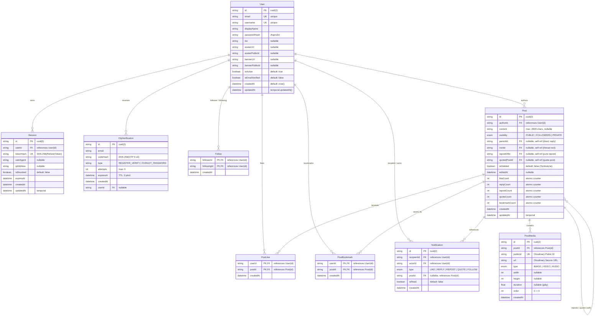
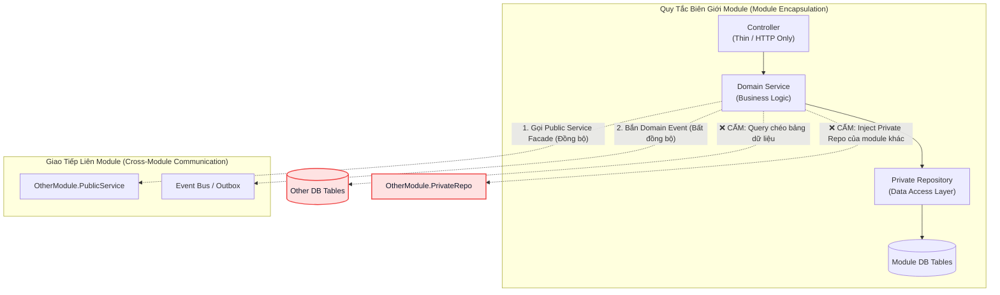

# 02. Cơ Sở Dữ Liệu & Tầng Backend (Database & Backend Blueprint)

Tài liệu này chi tiết hóa kiến trúc tầng dữ liệu (Database Schema, Entity Relationship), quy trình vận hành migrations, vòng đời xử lý request (Request Lifecycle), cơ chế bảo mật/phân quyền, quy chuẩn quản lý media và **các tiêu chuẩn mở rộng theo Backend Architecture Playbook v3** của dịch vụ Backend (NestJS 12 + Fastify + PostgreSQL + Prisma 8).

---

## 1. Sơ Đồ ERD & Quy Ước Thiết Kế Database (Schema & Naming Conventions)

### 1.1. Sơ Đồ Thực Thể - Quan Hệ (ERD)

Toàn bộ thực thể và quan hệ trong hệ thống được định nghĩa chặt chẽ trong `backend/src/prisma/contract.prisma`:



### 1.2. Quy Ước Thiết Kế & Chuẩn Đặt Tên (Naming & Modeling Rules)

1.  **Chuẩn Đặt Tên Bảng & Cột**:
    -   **Tầng Code (Prisma / TypeScript)**: Model dùng `PascalCase` danh từ số ít (`User`, `Post`, `PostMedia`, `Notification`). Thuộc tính và quan hệ dùng `camelCase` (`authorId`, `isDeleted`, `likeCount`, `postLikes`).
    -   **Tầng Database (PostgreSQL)**: Prisma 8 tự động ánh xạ hoặc sử dụng format chuẩn của engine. Khi viết Raw SQL / Index migration, tên bảng tương ứng với model (`User`, `Post`) hoặc snake_case nếu cấu hình custom `@map`.
    -   **Cột Boolean**: Luôn bắt đầu bằng tiền tố trạng thái: `is` hoặc `has` (ví dụ: `isActive`, `isEmailVerified`, `isDeleted`, `isRevoked`, `isRead`).
2.  **Chuẩn Khóa Chính (Primary Key Standard)**:
    -   **Tuyệt đối không dùng Auto-Increment Integer (`SERIAL` / `BIGSERIAL`)**: Nhằm ngăn chặn kỹ thuật duyệt ID liên tục (ID Enumeration / Insecure Direct Object References - IDOR) và tránh lộ tổng số lượng bản ghi của hệ thống.
    -   **Chuẩn định danh: CUIDv2 (`@default(cuid(2))`)**:
        -   Được tối ưu hoá cho cơ sở dữ liệu quan hệ B-Tree Index: có tính đơn điệu theo thời gian (k-sortable), giảm hiện tượng phân mảnh trang (page fragmentation) tốt hơn UUIDv4 thuần túy.
        -   Định dạng chuỗi ngắn gọn, an toàn trên URL, hỗ trợ scale phân tán không trùng lặp mà không cần phối hợp tập trung.
    -   **Khóa chính kết hợp (Composite PK)**: Áp dụng cho các bảng quan hệ N-N để đảm bảo tính duy nhất ở tầng DB:
        -   `Follow`: `@@id([followerId, followingId])`
        -   `PostLike`: `@@id([userId, postId])`
        -   `PostBookmark`: `@@id([userId, postId])`
3.  **Các Cột Bắt Buộc & Quản Lý Vòng Đời**:
    -   `createdAt`: `DateTime @default(now())` ghi lại mốc thời gian tạo bản ghi (UTC).
    -   `updatedAt`: Sử dụng `temporal.updatedAt()` của Prisma 8 (hoặc database trigger native) để tự động cập nhật thời gian mỗi khi bản ghi có thay đổi.
    -   **Vòng đời Xóa (Tombstone vs Hard Delete)**:
        -   Với `Post`: Áp dụng kỹ thuật **Tombstone** (`isDeleted = true`, xóa `content = null` và xóa `PostMedia`). Khi một bài viết gốc trong một thread thảo luận bị xóa nhưng đã có người trả lời (`replyCount > 0`), dòng dữ liệu vẫn được giữ lại để không làm gãy toàn bộ cây hội thoại (Thread Tree).
        -   Với `Session`: Sử dụng cờ `isRevoked = true` để vô hiệu hóa phiên ngay tức khắc mà vẫn lưu vết kiểm toán (Audit Trail) phục vụ điều tra bảo mật.
4.  **Quy Chuẩn Phân Trang Tốc Độ Cao (Keyset / Cursor Pagination Standard - Playbook v3)**:
    -   **Cấm dùng Offset Pagination trên các bảng Feed & Danh sách lớn**: Tránh triệt để `OFFSET N LIMIT M` trên bảng bài viết vì Postgres phải scan và bỏ qua $N$ bản ghi, gây suy giảm hiệu năng $O(N)$ nghiêm trọng khi dữ liệu tăng trưởng.
    -   **Chuẩn Keyset (Cursor)**: Dựa trên cặp khóa đơn điệu `(createdAt, id)`:

        ```sql
        WHERE (p.createdAt < :cursorCreatedAt)
           OR (p.createdAt = :cursorCreatedAt AND p.id < :cursorId)
        ORDER BY p.createdAt DESC, p.id DESC
        LIMIT :limit
        ```

    -   Trả về cho Client `nextCursor` mã hóa base64 hoặc chuỗi `id`, đảm bảo tốc độ truy vấn luôn là hằng số $O(1)$ kể cả khi xem đến bài viết thứ 1 triệu.

---

## 2. Quy Trình Làm Việc Với ORM & Migration (Migration Playbook)

Dự án sử dụng **Prisma 8 ORM** với kiến trúc hợp đồng Type-Safe (`contract.prisma` $rightarrow$ `contract.json` $rightarrow$ TypeScript types) và driver native `@prisma/orm-postgres`.

### 2.1. Bảng Tổng Hợp Lệnh Thao Tác Cơ Sở Dữ Liệu

Mục đích

Câu lệnh (Thực thi trong `backend/`)

Ghi chú & Môi trường

**Sinh Type-Safe Contract**

`npm run contract:emit`

Xuất `contract.json` và `contract.d.ts` từ file schema `contract.prisma`. Bắt buộc chạy sau mỗi lần đổi schema.

**Chạy Seed Dữ Liệu Kiểm Thử**

`npm run seed`

Tạo 19 users giả lập, >100 bài viết, phân trang 3 tháng. Chỉ chạy khi `NODE_ENV !== 'production'`.

**Kiểm tra Dữ Liệu Seed**

`npm run seed:check`

Kiểm tra tính toàn vẹn của dữ liệu mẫu mà không làm thay đổi DB.

**Chạy Thử Seed (Dry-Run)**

`npm run seed -- --dry-run`

Kiểm tra kết nối và tính toán bản ghi mà không thực thi INSERT.

**Đồng bộ Lại Bộ Đếm (Counters)**

`npm run reconcile:counters`

Quét lại toàn bộ DB, tính toán lại chính xác `likeCount`, `replyCount`, `repostCount`, `bookmarkCount` theo quan hệ thực tế.

**Chạy Toàn Bộ Test Suite**

`npm test`

Chạy song song unit test & integration test của posts, auth, notifications, media, users, search, gateway.

### 2.2. Quy Tắc "Bất Khả Xâm Phạm" Khi Sửa Cấu Trúc Bảng

1.  **Tuyệt Đối Không Sửa File Migration Đã Merge**:
    -   Bất kỳ file migration nào nằm trong `backend/migrations/app/` đã được commit vào nhánh `main` là **bất biến**.
    -   Nếu có lỗi logic hoặc muốn đổi kiểu dữ liệu, bắt buộc phải tạo một migration mới để điều chỉnh (Roll-forward), không sửa đè (edit) vào file migration cũ.
2.  **Chiến Lược Hai Pha "Expand and Contract" Khi Thay Đổi Breaking**:
    -   Tuyệt đối không xóa cột hoặc đổi tên cột đang có traffic trên Production trong một bước duy nhất.
    -   **Pha 1 (Expand)**: Thêm cột mới dạng `NULLABLE` hoặc có `DEFAULT`. Deploy code backend mới ghi dữ liệu đồng thời vào cả cột cũ và cột mới.
    -   **Pha 2 (Backfill)**: Chạy script migrate dữ liệu lịch sử từ cột cũ sang cột mới.
    -   **Pha 3 (Contract)**: Chuyển code backend sang chỉ đọc/ghi cột mới. Tạo migration xóa cột cũ và đặt cột mới thành `NOT NULL`.
3.  **Quy Tắc Đánh Index An Toàn Trên Bảng Lớn**:
    -   Các bảng có dữ liệu tăng trưởng nhanh (`Post`, `Notification`, `PostLike`) khi đánh index mới trên môi trường Production phải kiểm tra nguy cơ khóa bảng (Table Lock). Nếu chạy SQL thuần, luôn ưu tiên cú pháp `CREATE INDEX CONCURRENTLY`.
4.  **Cấm Dùng `migrate reset` Ngoài Môi Trường Local**:
    -   Lệnh xóa và dựng lại DB (`migrate reset`) bị cấm triệt để trên mọi môi trường Staging/Production. Hệ thống chỉ cho phép tiến tới (apply pending migrations).

---

## 3. Cấu Trúc Phân Tầng Backend & Vòng Đời Request (Request Lifecycle & Layering)

### 3.1. Vòng Đời Chi Tiết Của Một Request (Request Lifecycle)

Mọi HTTP Request gửi tới backend đều trải qua quy trình 7 bước tiêu chuẩn, tích hợp sẵn cơ chế **Correlation ID Tracing**, **Tiered Throttling** và **Machine-Readable Error Codes**:

```mermaid
flowchart TD
    Req([HTTP Request từ Client]) --> Fastify[1. Fastify Engine & Tracing<br/>Gán / Nhận 'x-request-id' + Pino Logger]
    Fastify --> Throttler[2. Tiered Throttler Guard<br/>Auth: 10/min | Write: 30/min | Read: 150/min]
    Throttler --> AuthGuard[3. JwtAuthGuard / OptionalJwtAuthGuard<br/>Xác thực Access Token & Session DB]
    AuthGuard --> Validation[4. Global ValidationPipe<br/>class-validator DTO: Whitelist & Transform]
    Validation --> Idempotency[5. Idempotency Check<br/>Kiểm tra 'Idempotency-Key' trên POST/PUT]
    Idempotency --> Controller[6. Controller Layer<br/>Bóc tách DTO, Params & @CurrentUser]
    Controller --> Service[7. Service Layer<br/>Business Logic & Transactions]
    Service --> DB[(PostgreSQL via Prisma)]

    Service -.->|Ngoại lệ phát sinh| Filter[AllExceptionsFilter<br/>Chuẩn hóa JSON + errorCode + requestId]
    Filter -.-> ResErr([HTTP Error Response với Code])
    Service --> ResOk([HTTP 200/201 Success Response])
```

1.  **Fastify Engine & Request Tracing (Correlation ID - Playbook v3)**:
    -   Client có thể truyền lên header `x-request-id` hoặc Fastify tự sinh một mã định danh duy nhất (CUID/UUID).
    -   Mã `requestId` được đính kèm xuyên suốt toàn bộ vòng đời của request và được logger (Pino) in ra ở mọi log line.
    -   Header `x-request-id` được trả ngược lại trong Response Header giúp người dùng/frontend đối soát vết lỗi (Traceability) ngay khi gặp sự cố.
2.  **Tiered Throttler Guard (Phân Tầng Giới Hạn Tần Suất - Playbook v3)**: Thay vì áp dụng một ngưỡng phẳng (flat rate limit), hệ thống phân tách thành 3 tầng bảo vệ:
    -   **Tier 1 (Auth & Nhạy Cảm)**: `/auth/login`, `/auth/register`, `/auth/verify-otp`, `/auth/forgot-password` $rightarrow$ Giới hạn nghiêm ngặt **5 - 10 req/phút/IP** nhằm ngăn chặn Brute-force mật khẩu và lạm dụng dịch vụ gửi mail OTP.
    -   **Tier 2 (Write Mutations)**: `/posts` (tạo/sửa), `/media/upload-signature`, like/bookmark $rightarrow$ Giới hạn **20 - 30 req/phút/user** nhằm chống spam nội dung tự động.
    -   **Tier 3 (Read Queries)**: `/posts/feed`, `/posts/explore`, xem trang cá nhân $rightarrow$ Giới hạn rộng mở **100 - 200 req/phút/user**.
3.  **Auth Guards**:
    -   `JwtAuthGuard`: Giải mã JWT Access Token; gọi `AccessSessionService.verifyAccessToken()` kiểm tra xem phiên trong bảng `Session` có bị đánh dấu `isRevoked` hoặc hết hạn không.
    -   `OptionalJwtAuthGuard`: Sử dụng cho các API công khai nhưng có hành vi cá nhân hóa nếu đã đăng nhập (ví dụ: xem bài viết kèm cờ `isLiked`, `isBookmarked`).
4.  **Global ValidationPipe**:
    -   `whitelist: true`: Tự động loại bỏ mọi trường dữ liệu thừa không được khai báo trong DTO để chống tấn công Mass Assignment.
    -   `transform: true`: Tự động ép kiểu chuỗi sang số/boolean theo đúng định nghĩa TypeScript.
5.  **Cơ Chế Chống Trùng Lặp Thao Tác (Idempotency Key - Playbook v3)**:
    -   Với các mutation nhạy cảm (`POST /api/v1/posts`), client được khuyến nghị gửi kèm header `Idempotency-Key: <uuid>`.
    -   Backend lưu hash key này trong bộ đệm ngắn hạn (5 phút). Nếu người dùng bị lag mạng và vô tình bấm "Đăng" nhiều lần, backend chỉ thực thi 1 lần duy nhất và trả về ngay kết quả đã tạo trước đó.
6.  **Controller Layer**: Giữ code siêu mỏng (thin controller). Không chứa câu lệnh logic nghiệp vụ. Chỉ nhận input, chuyển tiếp vào Service và trả kết quả.
7.  **Service Layer**: Nơi duy nhất chứa các quy tắc nghiệp vụ, tính toán logic và gọi database.
8.  **Chuẩn Hóa Mã Lỗi Máy Đọc Được (Machine-Readable Error Codes - Playbook v3)**:

    -   `AllExceptionsFilter` bắt toàn bộ ngoại lệ và format theo chuẩn cấu trúc:

    ```json
    {
      "statusCode": 401,
      "code": "AUTH_SESSION_REVOKED",
      "message": "Phiên đăng nhập đã bị thu hồi hoặc đăng xuất từ thiết bị khác",
      "requestId": "cm3a9b1c2000008l0h9x0abc1",
      "timestamp": "2026-10-27T10:00:00.000Z",
      "path": "/api/v1/posts/feed"
    }
    ```

    -   **Danh mục mã lỗi chuẩn hệ thống (Error Code Catalog)**:
        -   `AUTH_INVALID_CREDENTIALS`: Sai email hoặc mật khẩu.
        -   `AUTH_ACCOUNT_LOCKED`: Tài khoản đang bị vô hiệu hóa (`isActive = false`).
        -   `AUTH_EMAIL_UNVERIFIED`: Tài khoản chưa xác thực OTP qua email.
        -   `AUTH_SESSION_EXPIRED` / `AUTH_SESSION_REVOKED`: Phiên hết hạn hoặc bị đăng xuất từ xa.
        -   `POST_NOT_FOUND` / `POST_FORBIDDEN_DELETE`: Không tìm thấy hoặc không có quyền thao tác trên bài viết.
        -   `MEDIA_INVALID_SIGNATURE`: Chữ ký số từ Cloudinary không khớp hoặc giả mạo.
        -   `VALIDATION_FAILED`: Dữ liệu đầu vào không hợp lệ.

### 3.2. Quy Tắc Sử Dụng Database Transaction & Outbox Pattern

1.  **Nguyên Tắc Bắt Buộc Transaction**: Bất kỳ nghiệp vụ nào làm biến đổi dữ liệu trên **từ hai bảng trở lên** hoặc yêu cầu tính toán nhất quán giữa bản ghi và bộ đếm (Atomic Counter) đều **bắt buộc** phải bọc trong transaction:

    ```typescript
    // Pattern chuẩn tại backend/src/posts/posts.service.ts
    await this.prismaService.client.transaction(async (tx) => {
        // 1. Tạo bản ghi bài viết
        const post = await tx.orm.public.Post.create({ ... });

        // 2. Tăng bộ đếm bài trả lời của post cha
        if (parentPost) {
            await tx.orm.public.Post
                .where({ id: parentPost.id })
                .update({ replyCount: parentPost.replyCount + 1 });
        }

        // 3. Tạo các bản ghi media liên kết
        for (const media of verifiedMedia) {
            await tx.orm.public.PostMedia.create({
                postId: post.id,
                publicId: media.publicId,
                ...
            });
        }
    });
    ```

2.  **Quy Tắc Tránh Nghẽn Connection Pool (Anti-Pattern)**:
    -   **Tuyệt đối không bọc các tác vụ I/O chậm vào trong Transaction**: Không được gọi API bên thứ ba (Cloudinary, Nodemailer) hoặc phát WebSocket bên trong block `tx.transaction()`.
    -   Các tác vụ external I/O phải được thực hiện **trước** khi mở transaction (để xác thực chữ ký) hoặc **sau** khi transaction đã commit thành công (để dọn dẹp file hoặc gửi thông báo).
3.  **Định Hướng Transactional Outbox Pattern (Event Reliability - Playbook v3)**:
    -   Hiện tại, hệ thống sử dụng `EventEmitter2` in-process cho các tác vụ side-effect (notification, websocket).
    -   **Lộ trình nâng cấp**: Khi phân tán hệ thống (Microservices / Multi-instance), để tránh mất sự kiện khi server crash đột ngột giữa lúc commit DB và emit event, nghiệp vụ sẽ áp dụng **Outbox Pattern**:
        -   Lưu sự kiện domain vào bảng `OutboxEvent` (status: `PENDING`) **ngay trong cùng DB transaction** của nghiệp vụ chính.
        -   Một tiến trình Worker độc lập quét bảng `OutboxEvent`, đẩy vào Message Queue (Redis / BullMQ) và đánh dấu `PROCESSED`.

---

## 4. Cơ Chế Xác Thực, Đồng Bộ User & Phân Quyền (Auth & Authorization)

### 4.1. Cơ Chế Xác Thực Nội Bộ & Khả Năng Đồng Bộ Bên Thứ Ba

Hệ thống cung cấp cơ chế xác thực nội bộ chuẩn doanh nghiệp và sẵn sàng mở rộng xác thực bên ngoài (OAuth / Third-Party):

```mermaid
graph TD
    subgraph InternalAuth ["Hệ Thống Auth Nội Bộ (Native Auth)"]
        Register[Đăng ký: Email + Password] --> HashPW[Băm mật khẩu: Argon2id]
        HashPW --> CreateUserUnverified[Tạo User: isEmailVerified = false]
        CreateUserUnverified --> GenOTP[Sinh OTP 6 số + Băm SHA-256]
        GenOTP --> SaveOTP[Lưu bảng OtpVerification, TTL 5 phút]
        SaveOTP --> SendMail[Nodemailer gửi Email xác thực]
        VerifyOTP[Xác nhận OTP] --> MatchOTP[So khớp mã băm SHA-256]
        MatchOTP --> ActivateUser[Cập nhật: isEmailVerified = true]
    end

    subgraph ThirdPartySync ["Mở Rộng OAuth / 3rd Party (Google / Clerk)"]
        OAuthCallback[OAuth Provider Callback] --> ExtractProfile[Trích xuất Email, ProviderId, Avatar]
        ExtractProfile --> FindUserByEmail{Email đã tồn tại trong DB?}
        FindUserByEmail -->|Chưa tồn tại| JITCreate[JIT Provisioning: Tạo User mới + isEmailVerified: true]
        FindUserByEmail -->|Đã tồn tại| LinkProvider[Liên kết ProviderId với User hiện tại]
        JITCreate --> IssueSession[Cấp phát Session & Cookies như luồng Native]
        LinkProvider --> IssueSession
    end
```



### 4.2. Kiểm Tra Quyền Sở Hữu Tài Nguyên (Resource Ownership Check)

Mọi thao tác chỉnh sửa hoặc xóa dữ liệu nhạy cảm đều được bảo vệ nghiêm ngặt ở tầng Service theo nguyên tắc **Chặn Sớm (Fail-Fast)**:

1.  **Quy Tắc Kiểm Tra Quyền Tác Giả Bài Viết (Post Author)**:

    ```typescript
    // Minh họa từ backend/src/posts/posts.service.ts
    const post = await this.prismaService.client.orm.public.Post
        .where({ id: postId })
        .first();

    if (!post || post.isDeleted) {
        throw new NotFoundException('Không tìm thấy bài viết');
    }

    // Bắt buộc so khớp authorId với userId trích xuất từ JWT
    if (post.authorId !== currentUserId) {
        throw new ForbiddenException('Bạn không có quyền thực hiện thao tác trên bài viết này');
    }
    ```

2.  **Quy Tắc Cập Nhật Hồ Sơ Cá Nhân (User Profile)**:
    -   Các API cập nhật thông tin cá nhân (`PATCH /users/profile`), đổi mật khẩu (`POST /users/change-password`) chỉ lấy `userId` trực tiếp từ decorator `@CurrentUser('sub')`, tuyệt đối không nhận `userId` từ body hay URL param của client.

---

## 5. Quy Chuẩn Lưu Trữ Media & Dọn Rác (Object Storage & Cleanup)

### 5.1. Cấu Trúc Khóa Lưu Trữ (Storage Path & Naming Convention)

Media được tổ chức theo thư mục có cấu trúc trên Cloudinary CDN nhằm cách ly dữ liệu giữa các người dùng:

Thư mục lưu trữ

Định dạng Path / Public ID

Mục đích

**Ảnh đại diện**

`mxh/{userId}/avatars/{publicId}`

Avatar cá nhân của người dùng

**Ảnh bìa trang cá nhân**

`mxh/{userId}/banners/{publicId}`

Ảnh cover banner trên profile

**Media bài viết**

`mxh/{userId}/posts/{publicId}`

Ảnh, video đính kèm bài viết hoặc thread

### 5.2. Giới Hạn Dung Lượng & Loại Tệp Tin (File Quota & MIME Types)

-   **Hình ảnh (`IMAGE`)**:
    -   Hỗ trợ định dạng: JPEG, PNG, WebP, GIF.
    -   Dung lượng tối đa: **10 MB** / tệp.
    -   Số lượng tối đa: **10 ảnh** / bài viết (`@ArrayMaxSize(10)`).
-   **Video (`VIDEO`)**:
    -   Hỗ trợ định dạng: MP4, WebM, QuickTime (MOV).
    -   Dung lượng tối đa: **100 MB** / tệp.

### 5.3. Cơ Chế Xác Thực Chữ Ký Chống Giả Mạo (Cloudinary Signature Verification)

Để ngăn chặn việc người dùng ác ý chèn ID ảnh của người khác hoặc gắn đường link độc hại vào bài viết, backend áp dụng cơ chế xác minh kép trước khi lưu DB:

```typescript
// backend/src/posts/posts.service.ts (verifyMediaItems)
private verifyMediaItems(userId: string, mediaItems: PostMediaItemDto[]) {
    const expectedPrefix = `mxh/${userId}/posts/`;

    for (const item of mediaItems) {
        // 1. Kiểm tra quyền sở hữu đường dẫn tệp tin
        if (!item.publicId.startsWith(expectedPrefix)) {
            throw new BadRequestException(`Media ${item.publicId} không thuộc quyền sở hữu của bạn`);
        }

        // 2. Tính toán lại chữ ký số phía server bằng SHA-1
        const signaturePayload = `public_id=${item.publicId}&version=${item.version}${apiSecret}`;
        const expectedSignature = crypto
            .createHash('sha1')
            .update(signaturePayload)
            .digest('hex');

        // 3. Đối chiếu chữ ký trả về từ Cloudinary
        if (item.signature !== expectedSignature) {
            throw new BadRequestException(`Chữ ký media ${item.publicId} không hợp lệ`);
        }
    }
}
```

### 5.4. Chiến Lược Dọn Rác & Thu Hồi Tài Nguyên (Cleanup Strategy)

1.  **Xóa Cascade Khi Xóa Bài Viết**:
    -   Khi bài viết bị xóa hoàn toàn khỏi DB hoặc chuyển sang trạng thái Tombstone:
    -   Backend gom toàn bộ danh sách `publicId` trong `PostMedia` trước khi xóa bản ghi DB.
    -   Sau khi DB transaction commit thành công, Service tiến hành gọi `MediaService.deleteFile(publicId, type)` để xóa vĩnh viễn file trên Cloudinary CDN, tránh lãng phí dung lượng lưu trữ:

        ```typescript
        // backend/src/media/media.service.ts
        async deleteFile(publicId?: string | null, mediaType: 'IMAGE' | 'VIDEO' | 'AUDIO' = 'IMAGE') {
            if (!publicId) return;
            const resourceType = mediaType === 'IMAGE' ? 'image' : 'video';
            await cloudinary.uploader.destroy(publicId, { resource_type: resourceType });
        }
        ```

2.  **Xử Lý Media Mồ Côi (Orphaned Uploads)**:
    -   Trường hợp người dùng đã tải file lên Cloudinary thành công nhưng tắt trình duyệt hoặc hủy đăng bài viết:
    -   **Chiến lược**: Định kỳ hàng tuần kích hoạt worker/script đối chiếu danh sách file trên Cloudinary với các `publicId` đang tồn tại trong bảng `PostMedia`, `User.avatarPublicId`, `User.bannerPublicId`. Bất kỳ tệp nào không có bản ghi tham chiếu trong DB quá 24 giờ sẽ được đưa vào hàng đợi dọn dẹp tự động.

---

## 6. Chính Sách Quản Trị Vòng Đời Dữ Liệu & Dọn Dẹp Định Kỳ (Data Retention & Purge Policy - Playbook v3)

Nhằm giữ cho dung lượng cơ sở dữ liệu PostgreSQL luôn gọn nhẹ, tối ưu hóa kích thước B-Tree Index và đảm bảo tuân thủ quyền riêng tư người dùng, hệ thống áp dụng lịch trình dọn dẹp dữ liệu định kỳ (Automated Purge Worker):

| Bảng dữ liệu | Điều kiện kích hoạt Purge | Chu kỳ thực thi | Hành động thực hiện |
| :--- | :--- | :--- | :--- |
| **`OtpVerification`** | Mã xác thực đã hết hạn (`expiresAt < NOW() - INTERVAL '1 day'`) | Hàng ngày (02:00 UTC) | **Hard Delete**: Xóa vĩnh viễn bản ghi OTP cũ để tránh phình to bảng xác thực. |
| **`Session`** | Phiên đã bị thu hồi (`isRevoked = true`) hoặc hết hạn quá 30 ngày (`expiresAt < NOW() - INTERVAL '30 days'`) | Hàng tuần (Chủ nhật 03:00 UTC) | **Hard Delete**: Xóa các phiên cũ đã hết giá trị kiểm toán để giải phóng bộ nhớ index `tokenHash`. |
| **`Notification`** | Các thông báo đã đọc (`isRead = true`) tạo cách đây hơn 90 ngày | Hàng tháng (Ngày 1 đầu tháng) | **Archive / Purge**: Xóa hoặc chuyển vào kho lưu trữ nguội (Cold storage), giữ danh sách thông báo nhẹ nhàng cho người dùng. |
| **Tombstone `Post`** | Bài viết `isDeleted = true` nhưng không có bất kỳ bài reply nào liên kết | Hàng tuần | **Purge**: Chuyển từ Tombstone sang Hard Delete nếu toàn bộ cây thread con phía dưới đã bị xóa sạch. |

---

## 7. Quy Chuẩn Lập Trình Backend Đẳng Cấp Doanh Nghiệp (Enterprise Backend Coding & Encapsulation Rules)

Phần này đóng vai trò là **"Hiến Pháp Kiến Trúc" (Architecture Law)** của dự án `mxh`. Mọi lập trình viên tham gia phát triển backend bắt buộc phải tuân thủ nghiêm ngặt các nguyên tắc dưới đây, đảm bảo hệ thống có thể mở rộng lên hàng trăm module mà không bị biến thành một "khối bùn lớn" (Big Ball of Mud).

### 7.1. Nguyên Tắc Đóng Gói Module & Private Repository Pattern



1. **Luật Sở Hữu Dữ Liệu Độc Quyền (Single Table Ownership)**:
   - Mỗi bảng trong Database chỉ được phép thuộc về **duy nhất một Module quản lý**:
     * `UsersModule` sở hữu: `User`, `Follow`, `OtpVerification`, `Session`.
     * `PostsModule` sở hữu: `Post`, `PostMedia`, `PostLike`, `PostBookmark`.
     * `NotificationsModule` sở hữu: `Notification`.
2. **Luật Private Repository (Nghiêm Cấm Truy Cập Chéo Bảng)**:
   - Repository là tài sản nội bộ (**Private**) của module.
   - Module A **TUYỆT ĐỐI CẤM** inject Repository hoặc viết lệnh `prisma.<bảng_khác>` chọc trực tiếp vào bảng do Module B sở hữu.
   - *Ví dụ*: `PostsService` cần kiểm tra trạng thái hoạt động của User trước khi đăng bài? **CẤM** viết `prisma.user.findUnique()`. Bắt buộc phải inject `UsersService` và gọi method công khai `await this.usersService.ensureActiveUser(userId)`.
3. **Hai Kênh Giao Tiếp Hợp Lệ Giữa Các Module**:
   - **Kênh 1: Public Service Interface (Đồng bộ - Synchronous)**:
     * Dùng khi Module A cần dữ liệu tức thời từ Module B để hoàn thành nghiệp vụ của mình.
     * Module B chỉ export các Service chứa các hàm public trả về DTO đã được đóng gói cẩn thận.
   - **Kênh 2: Domain Events (Bất đồng bộ - Asynchronous)**:
     * Dùng khi hành động ở Module A kéo theo hiệu ứng phụ (side-effects) ở Module B (như: Bài viết được like $\rightarrow$ sinh thông báo; Người dùng đổi mật khẩu $\rightarrow$ thu hồi socket realtime).
     * Module A chỉ cần phát ra sự kiện (`this.eventEmitter.emit(...)`). Module B tự đăng ký lắng nghe (`@OnEvent(...)`) và tự xử lý ghi vào bảng của mình. Hai bên đạt mức độ phân tách (Decoupling) tối đa.

---

### 7.2. 10 Quy Tắc Vàng Khi Viết Code Backend (The 10 Golden Engineering Rules)

#### Rule 1: Phân Tầng Trách Nhiệm Duy Nhất (Single Responsibility per Layer)
- **Controller (Siêu Mỏng - Thin Controller)**: Chỉ làm 3 việc: tiếp nhận HTTP request, kích hoạt validation DTO/Guard, chuyển tiếp dữ liệu vào Service và định dạng HTTP response.
  * *CẤM*: Không viết `if/else` nghiệp vụ, không gọi database, không tính toán dữ liệu trong Controller.
- **Service (Dày - Rich Domain Logic)**: Nơi duy nhất chứa quy tắc nghiệp vụ, điều phối transaction và phát domain events.
- **Repository (Truy Xuất - Data Access)**: Nơi duy nhất chứa các câu lệnh truy vấn Prisma/SQL, che giấu chi tiết lưu trữ khỏi tầng Service.

#### Rule 2: Cấm Trả Raw Database Model Ra Ngoại Vi (No Raw DB Leakage)
- Tuyệt đối không `return post` hay `return user` trực tiếp từ database ra Controller rồi gửi về Client.
- **Lý do**: Rất dễ vô tình làm lộ các trường nhạy cảm (`passwordHash`, `tokenHash`, `ipAddress`, `isDeleted`). Đồng thời khiến cấu trúc API Client bị phụ thuộc cứng vào cấu trúc cột DB (tight coupling).
- **Quy chuẩn**: Luôn đi qua **Response DTO** hoặc Mapper Function:
  ```typescript
  // ❌ SAI: Rò rỉ bản ghi DB nguyên bản
  @Get(':id')
  async getPost(@Param('id') id: string) {
      return this.postsService.findRaw(id); // Có thể lộ isDeleted, internal flags
  }

  // ✅ ĐÚNG: Đóng gói tường minh qua Response DTO
  @Get(':id')
  async getPost(@Param('id') id: string): Promise<PostResponseDto> {
      const post = await this.postsService.getPostById(id);
      return PostResponseDto.fromEntity(post);
  }
  ```

#### Rule 3: Guard Clauses & Triết Lý Chặn Sớm (Fail-Fast)
- Loại bỏ hoàn toàn mô hình `if/else` lồng nhau nhiều tầng (Pyramid of Doom) khiến mã nguồn khó theo dõi và dễ sót case.
- Luôn kiểm tra các điều kiện tiên quyết (Preconditions) và quăng lỗi (`throw Exception`) ngay ở những dòng đầu tiên của hàm:
  ```typescript
  // ✅ CHUẨN: Fail-Fast, code thẳng hàng, dễ đọc, dễ viết unit test
  async createReply(userId: string, parentId: string, content: string) {
      // 1. Kiểm tra tiền điều kiện ngay lập tức
      const user = await this.usersService.findActiveUser(userId);
      if (!user) throw new UnauthorizedException('Tài khoản không hợp lệ');

      const parent = await this.postsRepository.findById(parentId);
      if (!parent) throw new NotFoundException('Bài viết cha không tồn tại');
      if (parent.isDeleted) throw new BadRequestException('Không thể trả lời bài viết đã xóa');

      // 2. Thực thi nghiệp vụ chính bên dưới một cách an tâm
      return this.postsRepository.createReplyRecord({ ... });
  }
  ```

#### Rule 4: Giới Hạn Transaction & Cấm Network I/O Trong DB Lock
- Transaction được sinh ra để đảm bảo tính toán vẹn dữ liệu ACID giữa các bảng.
- **Quy Tắc Thép**: **Tuyệt đối cấm** gọi các tác vụ có độ trễ không đoán trước (gửi Email SMTP, upload file Cloudinary, gọi AI Gateway, phát WebSocket) bên trong khối `transaction(async (tx) => { ... })`.
- *Hậu quả nếu vi phạm*: Các câu lệnh mạng ngoài có thể mất từ 1–5 giây, giữ chặt kết nối DB trong connection pool $\rightarrow$ Cạn kiệt pool $\rightarrow$ Toàn bộ server bị nghẽn (Denial of Service tự gây ra).

#### Rule 5: Tính Nhất Quán Của Bộ Đếm (Atomic Mutation vs Memory Mutation)
- Trong mạng xã hội, các bộ đếm `likeCount`, `replyCount`, `repostCount` bị hàng nghìn người dùng cập nhật liên tục.
- **CẤM**: Đọc bản ghi từ DB lên biến JavaScript trong RAM, cộng `count + 1`, rồi lưu ngược lại (chắc chắn gây mất dữ liệu do Race Condition khi 2 request chạy đồng thời).
- **BẮT BUỘC**: Sử dụng câu lệnh tăng/giảm nguyên tử (Atomic Increment/Decrement) ở tầng SQL Database:
  ```sql
  -- Atomic Counter Update (An toàn tuyệt đối dưới tải cao)
  UPDATE "Post" SET "likeCount" = "likeCount" + 1 WHERE "id" = :postId;
  ```

#### Rule 6: Ngoại Lệ Nghiệp Vụ Có Danh Tính (Strongly-Typed Domain Errors)
- Tránh `throw new BadRequestException('Lỗi rồi')` bằng chuỗi văn bản chung chung.
- Xây dựng các lớp Exception nghiệp vụ mang danh tính rõ ràng:
  - `PostNotFoundException(postId)`
  - `UnauthorizedResourceAccessException(userId, resourceId)`
  - `SessionRevokedException()`
- Nhờ đó, Exception Filter ở tầng ngoài cùng sẽ tự động trích xuất đúng HTTP Status Code và `code` máy đọc được (`AUTH_SESSION_REVOKED`, `POST_NOT_FOUND`) một cách đồng nhất.

#### Rule 7: Sẵn Sàng Phân Tách Luồng Đọc và Ghi (CQRS-Lite Readiness)
- **Luồng Ghi (Write / Command)**: Tối ưu cho tính đúng đắn và toàn vẹn dữ liệu. Bắt buộc kiểm tra quyền sở hữu (Ownership check), bọc Transaction khi cần, và phát Domain Event.
- **Luồng Đọc (Read / Query)**: Tối ưu cho tốc độ và khả năng chịu tải. Được phép dùng projection chỉ lấy các trường cần thiết, tận dụng Keyset Cursor Pagination, và bypass các bước xử lý phức tạp không cần thiết.

#### Rule 8: Che Giấu Thư Viện Bên Thứ Ba Bằng Adapter Pattern (Vendor Agnostic)
- Code nghiệp vụ lõi trong `Services` không được phụ thuộc trực tiếp vào SDK của nhà cung cấp cụ thể (tránh Vendor Lock-in).
- *Ví dụ*: Không gọi trực tiếp `cloudinary.uploader.destroy()` rải rác trong `PostsService`. Thay vào đó, gọi qua interface trừu tượng `StorageService.deleteFile(publicId)`.
- *Lợi ích*: Khi dự án quyết định chuyển từ Cloudinary sang **Cloudflare R2** hoặc **AWS S3**, ta chỉ cần viết lại 1 file Adapter mới thực thi interface đó mà không cần sửa đổi một dòng code nào trong `PostsService`.

#### Rule 9: Viết Logic Nghiệp Vụ Phức Tạp Bằng Hàm Thuần Khiết (Pure Functions)
- Các thuật toán tính điểm trending feed, bóc tách hashtag `#topic`, trích xuất mention `@username`, hoặc kiểm tra chữ ký HMAC phải được tổ chức thành các **Pure Function** (cùng input $\rightarrow$ luôn trả về cùng output, không phụ thuộc vào trạng thái DB bên ngoài).
- *Lợi ích*: Cực kỳ dễ dàng viết Unit Test đạt độ phủ 100% với thời gian chạy chỉ vài mili-giây mà không cần dựng mock database phức tạp.

#### Rule 10: Cơ Chế Tự Chữa Lành Dữ Liệu (Self-Healing & Data Reconcilers)
- Trong hệ thống có bộ đếm phi chuẩn hóa (denormalized counters), dù thiết kế chuẩn đến đâu vẫn có xác suất nhỏ bị lệch số liệu do database crash hoặc sự cố ngoài ý muốn.
- **Quy định**: Mọi tính năng sử dụng bộ đếm hoặc trạng thái bất đồng bộ phải có **Reconciler Script** đi kèm (như `src/scripts/reconcile-counters.ts`). Định kỳ hoặc khi có nghi ngờ sai lệch, Reconciler sẽ quét và tự động đồng bộ lại bộ đếm từ quan hệ thực tế (Truth of Source).

---

### 7.3. Bảng Đối Chiếu Code Smells (Anti-Patterns) vs Clean Architecture

| Trường hợp (Scenario) | ❌ Anti-Pattern (Cấm Làm) | ✅ Clean Architecture (Chuẩn Dự Án) |
| :--- | :--- | :--- |
| **Truy vấn user trong Posts Module** | `this.prisma.user.findUnique({ where: { id } })` | `await this.usersService.findActiveUser(id)` |
| **Bình luận bài viết gây thông báo** | `PostsService` gọi trực tiếp `NotificationsService.createNotification()` (gây circular dependency) | `PostsService` phát event `this.eventEmitter.emit(POST_EVENTS.REPLIED, payload)` |
| **Tăng lượt thích (Like Counter)** | `post.likeCount += 1; await this.prisma.post.update(...)` (Race condition) | Dùng lệnh Atomic: `UPDATE "Post" SET "likeCount" = "likeCount" + 1 WHERE id = ...` |
| **Trả dữ liệu API bài viết** | `return this.prisma.post.findFirst(...)` (Lộ `isDeleted`, raw structure) | `return PostResponseDto.fromEntity(post)` |
| **Tác vụ gửi mail trong đăng ký** | Bọc `this.mailService.sendOtp()` bên trong `prisma.transaction()` (Giữ DB connection) | Commit transaction tạo User + OTP trước, sau đó mới gọi gửi Mail ở ngoài |
| **Kiểm tra quyền sửa/xóa** | Nhận `userId` từ `req.body.userId` của client (Lỗ hổng IDOR) | Bắt buộc lấy `userId` từ token `@CurrentUser('sub')` và so khớp với `authorId` trong DB |
