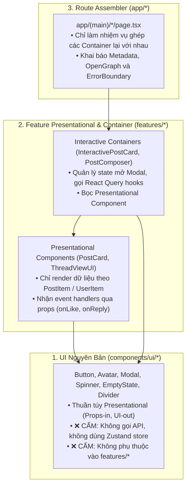
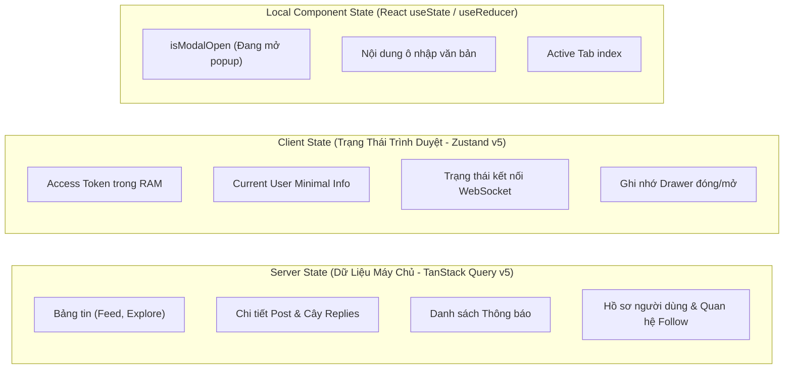
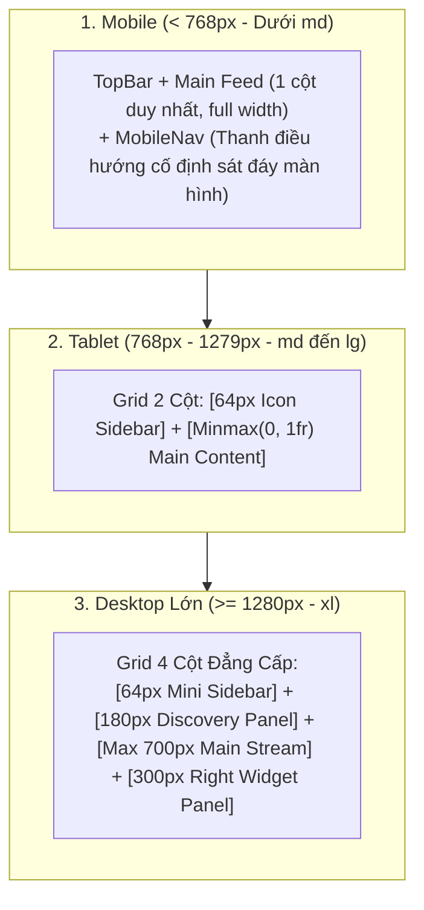

# 03. Kiến Trúc Giao Diện & Tầng Frontend (Frontend & UI Blueprint)

Tài liệu này định hình kiến trúc toàn diện của ứng dụng Client (Next.js 16 App Router + React 19 + Tailwind CSS v4 + TanStack Query v5 + Zustand v5). Đây là **Bộ Quy Chuẩn Bắt Buộc (Frontend Constitution)** giúp toàn bộ đội ngũ phát triển giao diện đồng nhất, tối ưu hiệu năng và dễ dàng bảo trì khi mở rộng quy mô.

---

## 1. Cấu Trúc Thư Mục Frontend & Ranh Giới Component (Directory & Component Architecture)

### 1.1. Bản Đồ Thư Mục Client

Ứng dụng Frontend được tổ chức theo kiến trúc **Feature-Driven kết hợp Atomic Design System**, phân tách tuyệt đối giữa các nguyên tử giao diện không trạng thái và các module nghiệp vụ:

```text
frontend/
├── app/                      # Next.js App Router (Routing, Layouts, Metadata)
│   ├── (auth)/               # Route Group: Các trang xác thực (login, register, verify-otp, forgot-password)
│   ├── (main)/               # Route Group: Bố cục chính Dashboard 4 cột (feed, explore, bookmarks, post/[id], [username])
│   ├── globals.css           # Tailwind v4 configuration (@theme, pastel tokens, custom utilities)
│   ├── layout.tsx            # Root HTML & Global Font / Metadata Layout
│   └── providers.tsx         # Root Providers (React Query, Auth Bootstrap, Global Single-Flight Session Init)
├── components/               # Các UI Components dùng chung toàn dự án
│   ├── common/               # Component nghiệp vụ chia sẻ (InfiniteScrollTrigger, TimeAgo, NavigationProvider, PostList)
│   ├── layout/               # Thành phần khung layout (Sidebar, TopBar, MobileNav, RightPanel, DiscoveryPanel)
│   └── ui/                   # Design System Nguyên Tử (Atoms - Stateless): Avatar, Button, Modal, Spinner, EmptyState
├── features/                 # Kiến trúc Feature-Driven (Đóng gói trọn vẹn theo miền nghiệp vụ)
│   ├── auth/                 # Hooks (useAuth), Components (LoginForm, RegisterForm), API callers
│   ├── media/                # Upload widget, Cloudinary Direct Picker, Media Preview Grid
│   ├── notifications/        # Notification List, NotificationRow, notification store listeners
│   ├── posts/                # Feed Composer, PostCard, ThreadViewUI, ReplyThread, InteractivePostCard
│   ├── realtime/             # Socket bridge, hook `useSocket`, listener đồng bộ
│   └── users/                # ProfileHeader, UserRow, UserList, EditProfileModal
├── lib/                      # Hạ tầng kỹ thuật, axios client, single-flight, utils
├── stores/                   # Zustand Stores (Client Memory State: authStore, notificationStore)
└── types/                    # TypeScript Data Contracts & Response DTOs từ API
```

---

### 1.2. Phân Định Ranh Giới: UI Nguyên Bản vs Giao Diện Nghiệp Vụ

Nhằm triệt tiêu sự phụ thuộc chéo (Coupling), dự án quy định 3 cấp độ Component rõ rệt:



1. **`components/ui/*` (Design System Atoms)**:
   - Là các viên gạch nguyên tử không trạng thái nghiệp vụ (Stateless/Presentational).
   - **Luật bất khả xâm phạm**: Không được `import` bất kỳ file nào từ `features/`, `stores/` hay gọi `apiClient`. Chỉ nhận `props` cơ bản (`variant`, `size`, `onClick`, `children`, `disabled`).
2. **`features/<domain>/components/*` (Presentational vs Container Pattern)**:
   - **Presentational Component (ví dụ: `PostCard.tsx`)**: Chịu trách nhiệm hiển thị giao diện đẹp, nhận vào dữ liệu `post: PostItem` và các callback `onLike`, `onReply`, `onDelete`. Không tự ý kích hoạt API call.
   - **Interactive Container (ví dụ: `InteractivePostCard.tsx`)**: Bọc bên ngoài Presentational Component, gắn kết với React Query mutation (`useLikePost`), quản lý việc bật tắt `EditPostModal` khi người dùng nhấn nút sửa bài.

---

### 1.3. Ranh Giới Giữa Server Components (RSC) và Client Components (`'use client'`)

Trong Next.js 16 App Router, mặc định mọi file trong `app/` đều là **React Server Components (RSC)** trừ khi có chỉ thị `'use client'`.

| Tiêu chí | Server Components (RSC) | Client Components (`'use client'`) |
| :--- | :--- | :--- |
| **Vị trí chạy** | Chỉ thực thi trên Server (Node.js runtime khi build hoặc SSR). | Chạy SSR lần đầu trên server, sau đó hydrate và chạy trên Trình duyệt. |
| **Khi nào bắt buộc dùng** | - Trang tĩnh, trang đọc dữ liệu SEO, Server Layout (`app/layout.tsx`).<br/>- Tạo thẻ `export const metadata = {...}` cho SEO.<br/>- Đọc trực tiếp biến môi trường nhạy cảm trên server. | - Component có tương tác: `onClick`, `onChange`, `onSubmit`.<br/>- Dùng React Hooks: `useState`, `useEffect`, `useRef`.<br/>- Dùng Zustand stores (`useAuthStore`) hoặc React Query (`useQuery`).<br/>- Thao tác trực tiếp với Browser API: `window`, `localStorage`, `document`. |
| **Quy tắc vàng (RSC Boundary)** | Giữ Server Component ở tầng **ngoài cùng** (Pages/Layouts) càng nhiều càng tốt. Đẩy chỉ thị `'use client'` xuống các lá cây (Leaf Nodes) sâu nhất có thể. | **CẤM** đánh dấu `'use client'` trên toàn bộ trang `page.tsx` nếu bên trong chỉ có một nút bấm cần tương tác. Hãy tách riêng nút bấm đó thành Client Component. |

```tsx
// ✅ CHUẨN: app/(main)/post/[id]/page.tsx là Server Component để render Metadata SEO
import { Metadata } from 'next';
import { InteractivePostView } from '@/features/posts/components/InteractivePostView';

export async function generateMetadata({ params }: { params: { id: string } }): Promise<Metadata> {
  // Fetch nhẹ metadata phục vụ Open Graph crawler
  return {
    title: `Bài viết thảo luận | MXH`,
    description: `Xem chi tiết cuộc trò chuyện trên MXH...`,
  };
}

export default function PostDetailPage({ params }: { params: { id: string } }) {
  // Lá cây InteractivePostView là Client Component đảm nhiệm tương tác Like, Reply
  return <InteractivePostView postId={params.id} />;
}
```

---

## 2. Chiến Lược Quản Lý Trạng Thái & Lấy Dữ Liệu (State Management & Data Fetching)

### 2.1. Phân Định Minh Bạch: Server State vs Client State

Một trong những sai lầm tai hại nhất ở frontend là đưa toàn bộ dữ liệu trả về từ API vào Redux/Zustand. Dự án thiết lập quy tắc phân loại trạng thái như sau:



1. **Server State $\rightarrow$ Quản lý bằng `@tanstack/react-query`**:
   - Mọi dữ liệu có nguồn gốc từ API backend (`/posts`, `/users`, `/notifications`).
   - Tự động tận dụng: Cơ chế Caching, tự động làm mới trong nền (Background Refetching), loại bỏ trùng lặp (Deduplication), phân trang Cursor vô tận (Infinite Scroll), và quản lý trạng thái Stale/Fresh.
   - **Quy tắc Query Key nhất quán**:
     * `['posts', 'feed']`
     * `['posts', 'detail', postId]`
     * `['posts', 'replies', postId]`
     * `['users', 'profile', username]`
     * `['notifications']`
2. **Client Global State $\rightarrow$ Quản lý bằng `zustand`**:
   - Chỉ lưu trữ các trạng thái tồn tại suốt phiên làm việc của người dùng mà không cần đồng bộ liên tục với DB:
     * `authStore`: Quản lý `accessToken` trong RAM, thông tin tóm tắt `user`, `sessionVersion`.
     * `notificationStore`: Quản lý số đếm thông báo chưa đọc (badge count) cập nhật tức thì qua Socket.IO.
3. **Local Component State $\rightarrow$ `useState`**:
   - Dùng cho các trạng thái phù du (ephemeral): toggle dropdown, mở popup xác nhận xóa bài, hiển thị form soạn thảo.

---

### 2.2. Chiến Lược Cập Nhật Lạc Quan (Optimistic Updates) & Làm Mới Bộ Nhớ Đệm

Với mạng xã hội, các thao tác tương tác (Like, Bookmark, Repost) **phải phản hồi ngay lập tức (dưới 16ms)** trên UI mà không được chờ đợi mạng backend:

```typescript
// Pattern chuẩn Optimistic Update với TanStack Query v5
export function useLikePost() {
  const queryClient = useQueryClient();

  return useMutation({
    mutationFn: (postId: string) => postsApi.likePost(postId),
    onMutate: async (postId: string) => {
      // 1. Hủy bỏ mọi truy vấn đang chạy đến post này để không ghi đè dữ liệu lạc quan
      await queryClient.cancelQueries({ queryKey: ['posts'] });

      // 2. Snapshot lại giá trị cũ để rollback nếu API lỗi
      const previousData = queryClient.getQueryData(['posts', 'detail', postId]);

      // 3. Cập nhật trực tiếp vào cache ngay lập tức (UI nhảy số like tức thì)
      queryClient.setQueryData(['posts', 'detail', postId], (old: PostItem) => {
        if (!old) return old;
        return {
          ...old,
          interactions: { ...old.interactions, isLiked: true },
          likeCount: old.likeCount + 1,
        };
      });

      return { previousData };
    },
    onError: (err, postId, context) => {
      // 4. Nếu server trả lỗi (400, 500) -> Rollback lại giá trị ban đầu
      if (context?.previousData) {
        queryClient.setQueryData(['posts', 'detail', postId], context.previousData);
      }
    },
    onSettled: (data, err, postId) => {
      // 5. Luôn làm mới lại dữ liệu từ nguồn chân lý (Source of Truth) khi kết thúc
      queryClient.invalidateQueries({ queryKey: ['posts', 'detail', postId] });
    },
  });
}
```

---

### 2.3. Quy Chuẩn Trạng Thái Chờ (Skeletons) & Bắt Lỗi (Error Boundaries & EmptyState)

1. **Tuyệt đối không dùng Spinner xoay giữa màn hình cho nội dung dạng danh sách (Feed/Comments)**:
   - Người dùng trải nghiệm giật lag nếu màn hình trắng xóa rồi đột ngột hiện nội dung.
   - **Bắt buộc**: Sử dụng **Skeleton Shimmer** mô phỏng chính xác khung thẻ bài viết (Avatar tròn xám nhấp nháy, 2 dòng tiêu đề, 1 khung ảnh placeholder).
2. **Xử lý trạng thái rỗng (Empty States)**:
   - Khi truy vấn trả về danh sách rỗng (`posts.length === 0`), luôn render component `components/ui/EmptyState.tsx` với thông điệp thân thiện, hình minh họa pastel và nút kêu gọi hành động (Call to Action - CTA), ví dụ: *"Chưa có bài viết nào ở đây. Hãy là người đầu tiên chia sẻ suy nghĩ!"*.
3. **Bắt lỗi toàn cục với Error Boundaries**:
   - Mọi khu vực cuộn chính (`#main-scroll-region`) đều được bọc bởi React Error Boundary để khi một bài viết bị lỗi render media, toàn bộ ứng dụng không bị trắng trang (Crash).

---

## 3. Quy Chuẩn Thiết Kế, Hệ Thống Màu & Responsive (Design System, Styling & Responsive Rules)

### 3.1. Hệ Thống Màu Sắc & Tokens (Tailwind CSS v4 Pastel Palette)

Dự án áp dụng ngôn ngữ thiết kế **Hiện Đại - Tươi Sáng - Pastel UI** được định nghĩa bằng các CSS Variables trong `frontend/app/globals.css` thông qua cú pháp `@theme` của Tailwind v4:

| Token Class | Mã Hex | Ý nghĩa & Vùng áp dụng |
| :--- | :--- | :--- |
| **`color-primary`** | `#7b78ff` | Màu tím pastel chủ đạo: Nút bấm chính, viền focus, highlight tab active, link hover. |
| **`color-ink`** | `#1c1b29` | Màu chữ chính (Độ tương phản cao, êm mắt hơn đen tuyền `#000000`). |
| **`color-body`** | `#4a4860` | Màu chữ phụ, mô tả phụ, bio người dùng. |
| **`color-muted`** | `#8e8ca3` | Thời gian đăng bài (`TimeAgo`), icon không kích hoạt, placeholder ô nhập. |
| **`color-canvas`** | `#f4f2fa` | Màu nền ứng dụng bên trong dashboard shell. |
| **`color-surface`** | `#ffffff` | Màu nền thẻ bài viết, thanh sidebar, modal popup (`surface-card`). |
| **`color-pink`** | `#ff8da1` | Màu nút Tim / Thích (`post-action-like`). |
| **`color-cyan`** | `#64b5f6` | Màu nút Trả lời / Bình luận (`post-action-reply`). |
| **`color-mint`** | `#6ee7b7` | Màu nút Đăng lại / Repost (`post-action-repost`). |
| **`color-gold`** | `#ffd166` | Màu nút Lưu bài viết / Bookmark (`post-action-bookmark`). |

---

### 3.2. Quy Chuẩn Breakpoints & Bố Cục Thích Ứng (Responsive Layout Architecture)

Giao diện áp dụng nguyên tắc **Mobile-First**, co giãn linh hoạt theo 3 mốc màn hình tiêu chuẩn:



- **Mobile Viewport (< 768px)**:
  * Ẩn thanh Sidebar bên trái và Right Panel bên phải.
  * Hiển thị thanh `MobileNav` ghim cố định đáy màn hình có tính toán phần lùi tai thỏ `pb-[calc(96px+env(safe-area-inset-bottom))]`.
- **Tablet Viewport (`md`: $\ge$ 768px)**:
  * Khung Dashboard bo góc mềm mại `md:rounded-[36px]` với đổ bóng sâu `dashboard-shell`.
  * Cột Sidebar mini 64px chứa các icon điều hướng chính.
- **Desktop Siêu Rộng (`xl`: $\ge$ 1280px)**:
  * Kích hoạt đầy đủ **Bố Cục 4 Cột Tối Ưu**:
    1. Cột 1: `64px` — Sidebar điều hướng cốt lõi (Trang chủ, Khám phá, Thông báo, Hồ sơ).
    2. Cột 2: `180px` — Discovery Panel (Lối tắt nhanh: Đã thích, Đã lưu, Chủ đề hot).
    3. Cột 3: `minmax(0, 1fr)` — Không gian dòng thời gian chính, giới hạn bề rộng đọc lý tưởng `max-w-[700px]`.
    4. Cột 4: `300px` — Right Panel (Lịch tương tác, gợi ý kết bạn, thông tin hệ thống).

---

### 3.3. Quản Lý Assets Tối Ưu (Icons, Typography & Media)

1. **Icons**:
   - Sử dụng hoàn toàn SVG nội tuyến hoặc icon nhẹ, chuẩn hóa kích thước qua CSS (ví dụ `.post-action svg` chuẩn 32x32px bo tròn 999px).
   - Tuyệt đối không import cả thư viện icon đồ sộ nếu chỉ dùng vài biểu tượng.
2. **Typography**:
   - Font chữ hệ thống ưu tiên font hiện đại qua `next/font`: `"Plus Jakarta Sans", "Nunito", sans-serif` nạp dạng biến thể tự động (Variable Font), loại bỏ hoàn toàn hiện tượng nhấp nháy chuyển font (Layout Shift - CLS).

---

## 4. Xử Lý Biểu Mẫu & Kiểm Tra Dữ Liệu (Form Handling & Validation)

### 4.1. Quy Chuẩn Xây Dựng Form

Mọi Form trong ứng dụng (Đăng ký, Đăng nhập, Tạo bài viết, Sửa hồ sơ) phải tuân theo 4 tiêu chuẩn bắt buộc:

1. **Trạng thái vô hiệu hóa khi đang xử lý (Pending State)**:
   - Khi người dùng nhấn "Đăng ký" hoặc "Đăng bài", nút submit phải lập tức chuyển sang trạng thái `isLoading={true}` và `disabled={true}` để chống việc double-click gửi trùng request.
2. **Hiển thị lỗi trường tường minh (Field-Level Error Messages)**:
   - Lỗi dữ liệu không hợp lệ phải xuất hiện ngay bên dưới ô input tương ứng bằng chữ màu đỏ hồng dịu mắt (`text-red-500 text-[12px]`), kèm viền đỏ nhạt quanh ô nhập.
3. **Phản hồi lỗi máy chủ qua Bộ Chuyển Đổi `getApiErrorMessage`**:
   - Sử dụng tiện ích `lib/api-error.ts` để bóc tách thông điệp từ backend:
   ```typescript
   try {
     await authApi.login(payload);
   } catch (err: unknown) {
     const friendlyMessage = getApiErrorMessage(err, 'Đăng nhập thất bại. Vui lòng thử lại!');
     setError(friendlyMessage);
   }
   ```

---

### 4.2. Quy Tắc Đồng Bộ Schema Xác Thực (Client Validation Schema)

Client sử dụng thư viện kiểm tra dữ liệu tương thích với DTO của Backend để đảm bảo **Chặn Sớm Lỗi Ngay Tại Trình Duyệt** trước khi phát sinh request qua mạng:

```typescript
// Ví dụ: Quy chuẩn Schema bài viết (Đồng bộ với CreatePostDto của Backend)
export const createPostSchema = {
  validate: (data: { content?: string; media?: unknown[] }) => {
    const trimmed = data.content?.trim() || '';
    const hasMedia = Array.isArray(data.media) && data.media.length > 0;

    if (!trimmed && !hasMedia) {
      return 'Bài viết phải có nội dung chữ hoặc đính kèm ít nhất một hình ảnh/video.';
    }
    if (trimmed.length > 2000) {
      return 'Nội dung bài viết không được vượt quá 2000 ký tự.';
    }
    if (data.media && data.media.length > 10) {
      return 'Chỉ được phép đính kèm tối đa 10 tệp phương tiện.';
    }
    return null; // Dữ liệu hợp lệ
  },
};
```

---

## 5. Quy Chuẩn Tối Ưu & Hiệu Năng (Performance & SEO)

### 5.1. Quy Tắc Tối Ưu Hình Ảnh & Media (Next/Image & Cloudinary)

Media là thành phần chiếm hơn 80% dung lượng tải trang của một mạng xã hội:

1. **Avatar & Khung Cố Định**:
   - Với ảnh đại diện người dùng: Luôn chỉ định kích thước cố định `width={size}` và `height={size}` để trình duyệt dành sẵn khung render, triệt tiêu CLS (Cumulative Layout Shift).
   - Tự động fallback về chữ cái đầu tiên của tên (`initials`) trên nền gradient pastel nếu người dùng chưa cập nhật avatar.
2. **Dynamic Cloudinary CDN Transformations**:
   - Không bao giờ tải ảnh gốc dung lượng 10MB từ Cloudinary về client.
   - Khi render trên feed, client thêm các cờ tối ưu trên URL Cloudinary:
     * `f_auto`: Cloudinary tự nhận diện trình duyệt để trả về WebP hoặc AVIF.
     * `q_auto:good`: Tự động nén ảnh giữ nguyên chất lượng hiển thị nhưng giảm 60% dung lượng.
     * `w_800,c_limit`: Giới hạn chiều rộng ảnh tối đa 800px phù hợp với khung feed 700px.
3. **Lazy Loading Media Grid**:
   - Các media nằm ngoài tầm nhìn (below the fold) mặc định áp dụng `loading="lazy"`. Chỉ nạp ảnh đầu tiên của bài viết trên đỉnh màn hình với cờ ưu tiên.

---

### 5.2. Cấu Hình Metadata & Thẻ Open Graph (Rich Social Previews)

Để bài viết và hồ sơ cá nhân khi chia sẻ qua Zalo, Facebook, Telegram hay X (Twitter) hiển thị thẻ xem trước đẹp mắt:

```typescript
// app/(main)/[username]/page.tsx
import type { Metadata } from 'next';
import { usersApi } from '@/features/users/api';

export async function generateMetadata({
  params,
}: {
  params: Promise<{ username: string }>;
}): Promise<Metadata> {
  const { username } = await params;

  return {
    title: `${username} | MXH`,
    description: `Khám phá những khoảnh khắc và chia sẻ mới nhất từ ${username} trên MXH.`,
    openGraph: {
      title: `${username} trên MXH`,
      description: `Xem các bài viết và kết nối cùng ${username}.`,
      type: 'profile',
      images: [
        {
          url: `/api/og/profile?u=${username}`, // Ảnh xem trước tạo động
          width: 1200,
          height: 630,
          alt: `Hồ sơ cá nhân ${username}`,
        },
      ],
    },
    twitter: {
      card: 'summary_large_image',
      title: `${username} trên MXH`,
    },
  };
}
```

---

### 5.3. Kiểm Soát Render Thừa & Tối Ưu Bộ Nhớ (Re-render Hygiene)

1. **Sử dụng Zustand Selectors Chọn Lọc**:
   - **Tuyệt đối cấm**: `const { user, token, sessionVersion } = useAuthStore();`
   - **Bắt buộc**: Luôn dùng selector để component chỉ re-render khi đúng trường nó quan tâm thay đổi:
     ```typescript
     // ✅ CHUẨN: Chỉ re-render khi avatarUrl thay đổi
     const userAvatar = useAuthStore((s) => s.user?.avatarUrl);
     ```
2. **Infinite Scroll Hiệu Quả Với `IntersectionObserver`**:
   - Sử dụng component `components/common/InfiniteScrollTrigger.tsx` đặt ở đáy danh sách bài viết.
   - Chỉ kích hoạt hàm `fetchNextPage()` khi trigger lọt vào vùng nhìn của viewport (với `rootMargin: '200px'`), giải phóng hoàn toàn việc lắng nghe sự kiện `onScroll` thủ công gây giật lag trình duyệt.
